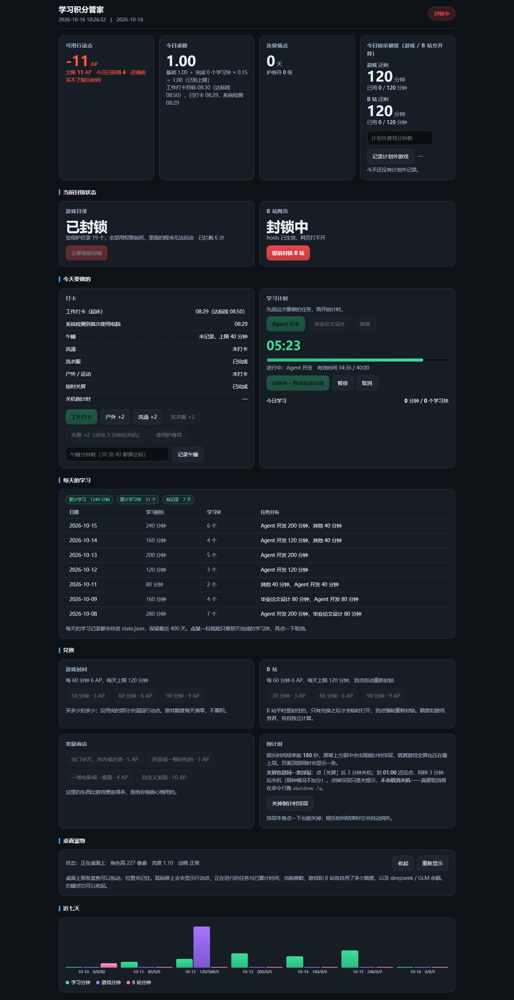
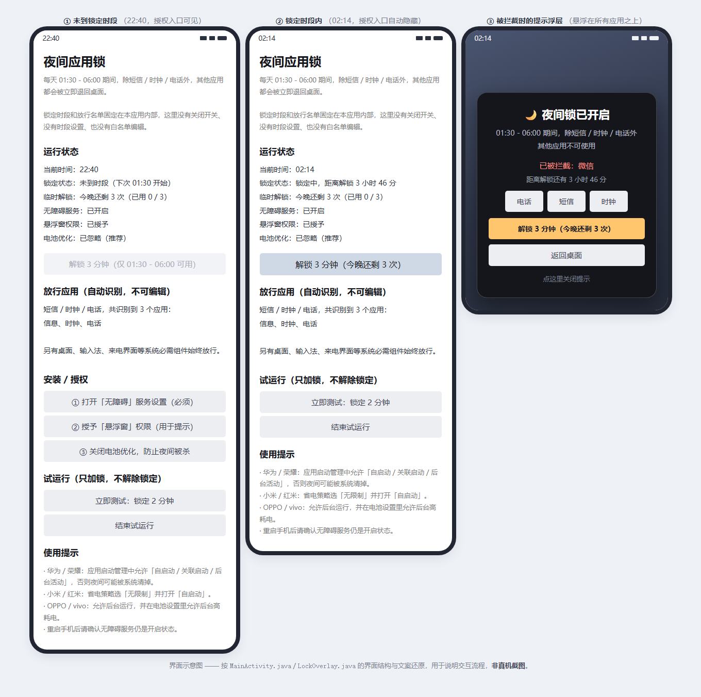

# life-guard 🐋🔒

两个**自己给自己上的锁**。都是先有需求、后有代码——不是玩具项目，是我本人每天在用的东西。

| 子项目 | 平台 | 一句话 | 代码量 |
|---|---|---|---|
| [**study-guard**](study-guard/) 学习积分管家 | Windows | 用行动点换游戏和 B 站时间，没兑换的时候两者都被系统锁死；附带一条会说话、会自己溜达的桌面鲸鱼 | Python 约 3500 行 + 单页面板 |
| [**night-app-lock**](night-app-lock/) 夜间应用锁 | Android | 01:30–06:00 之间，除了短信 / 时钟 / 电话，其余应用一律打不开 | Java 约 1370 行，APK 仅 29 KB |

两个项目解决的是同一个问题的两端：**白天在电脑上管住游戏和 B 站，夜里在手机上管住自己**。

### 学习积分管家




蓝色的鱼负责盯着你：悬停显示行动点、当前任务、乘数、当天学习与娱乐时长，以及 deepseek / GLM 余额。点一下它有 15 段回应动画轮换，闲着的时候会自己打哈欠、溜达、吃白饭——[26 段动作都在这里](study-guard/README.md#它会做的动作共-26-段)。

### 夜间应用锁



<sub>应用锁那张是**界面示意图**（按源码结构还原，非真机截图）：左 = 未到时段，授权入口可见；中 = 锁定时段内，负责授权的区块自动隐藏；右 = 被拦截时盖在所有应用之上的提示浮层。</sub>

---

## 为什么是「锁」而不是「提醒」

提醒依赖你当时还愿意听话。凌晨一点你已经不想听话了，任何靠自觉的机制都会在那时候失效。

所以这两个项目的做法都是：**把决定权放在你清醒的时候**。

- 锁在你想玩**之前**就已经落下了。双击游戏会被系统直接拒绝，B 站网页直接打不开，手机上打开微信会被弹回桌面。
- 封锁独立于程序存在。删掉程序目录、退出进程，权限和 hosts 照样是锁着的。
- 想解锁只有一条路：先干活，再兑换。
- 应用锁干脆把「关闭开关」「修改时段」「编辑白名单」三个入口从 App 里删掉了——留一个，就等于留一个半夜点的按钮。

防不住的是蓄意绕过。这台机器的管理员是你自己，真要研究怎么绕，总能绕过去。这一点不装作不存在——README 里也照实写了。

---

## 快速开始

**学习积分管家**（Windows 10/11，需要 Python 3）

```
右键 study-guard\安装.cmd → 以管理员身份运行
```

装完浏览器会自动打开面板 <http://127.0.0.1:8765>，桌面右下角会出现一条蓝鲸鱼。详见 [study-guard/说明.md](study-guard/说明.md)。

**夜间应用锁**（Android 5.0+）

直接装 [night-app-lock/NightAppLock.apk](night-app-lock/NightAppLock.apk)，然后开启无障碍服务即可。详见 [night-app-lock/README.md](night-app-lock/README.md)。

---

## 想改造成自己的

**默认值全是照我的作息定的，对你大概率不合适**——08:50 前打卡、40 分钟一个学习块、游戏和 B 站各 120 分钟、凌晨 01:30 锁手机。

能改的地方按改动成本分了 6 层，**前三层不用写一行代码**：

| 想做什么 | 看哪里 |
|---|---|
| 改作息 / 分数 / 上限 / 桌宠外观 | [DIY 第 1 层](DIY.md#第-1-层改-configjson)（改 JSON，10 秒生效） |
| 改封锁范围、把 B 站换成抖音 | [DIY 第 2 层](DIY.md#第-2-层改封锁范围) |
| 换桌宠角色、加动作、加台词 | [DIY 第 3 层](DIY.md#第-3-层换桌宠角色加动作) |
| 改面板配色、加自己的按钮 | [DIY 第 4 层](DIY.md#第-4-层改面板) |
| 改乘数公式、加新的奖惩 | [DIY 第 5 层](DIY.md#第-5-层改规则引擎) |
| 改应用锁的时段和白名单 | [DIY 第 6 层](DIY.md#第-6-层改应用锁) |

完整文档 → [**DIY.md**](DIY.md)，里面还有一节「[哪些改动会毁掉这个东西](DIY.md#红线哪些改动会毁掉这个东西)」——动手前建议先看一眼。

想一起改代码的话 → [**CONTRIBUTING.md**](CONTRIBUTING.md)，**欢迎 PR**：修 bug、补文档、加桌宠动作、做跨平台适配都缺人。`guard.py` 和 `pet.py` 加起来 3500 行，但**零第三方依赖**，clone 下来就能跑。

---

## 仓库结构

```
life-guard/
├── README.md             你在这里：总览 + 设计取舍 + 致谢
├── DIY.md                按想法改造的指南（分 6 层，从改 JSON 到改引擎）
├── CONTRIBUTING.md       贡献指南（欢迎 PR）
├── study-guard/          学习积分管家（Windows）
│   ├── guard.py          守护进程：计分、封锁目录、写 hosts、结算娱乐时间
│   ├── pet.py            桌面宠物：APNG 动画、气泡对话、余额查询
│   ├── dashboard.html    网页面板（单文件，无框架、无 CDN）
│   ├── config.json       所有可调项（脱敏模板，改完 10 秒生效）
│   ├── pet_anim/         动画清单 manifest.json（素材需自行生成）+ 生成脚本
│   ├── docs/             截图与动作一览
│   └── 说明.md            完整使用手册（440 行，每条规则的来龙去脉都在这里）
└── night-app-lock/       夜间应用锁（Android）
    ├── app/src/          Java 源码（无障碍服务 + 悬浮窗 + 主界面）
    ├── NightAppLock.apk  已签名的成品
    ├── docs/             界面示意
    ├── build.ps1         不用 Gradle 的手工构建脚本
    └── install.ps1       adb 一键安装 + 自动开权限
```

---

## 设计上的几个取舍

写的时候反复权衡过的几件事，都写在各自 README 里，这里列个索引：

- **行动点可以是负数**。罚款扣到 0 就停，等于「把钱花光」可以免疫惩罚，所以改成欠账，还清之前买不了娱乐时间。
- **移除封锁只能在文件里改**。面板上的勾选框只有「从没锁变锁上」一个方向，已经锁上的取消不了。
- **没有卸载脚本，也没有一键解锁**。按钮一旦存在，半夜就会去点它。
- **B 站到点要「掐一下网络」**。hosts 只管新的域名解析，浏览器已经在页面上时靠缓存照看不误，所以要重启浏览器的网络进程（标签页一个都不会关）。
- **应用锁 01:30–06:00 写死在代码里**，App 里改不了。
- **应用锁每天给 3 次「解锁 3 分钟」**。这是刻意的：完全不给出路，人会在别的地方找更野的路。

---

## 致谢

- 桌面宠物的**设计与动画素材**借鉴自 [**PC2005-cloud/dsh-pet**](https://github.com/PC2005-cloud/dsh-pet)（MIT License，Copyright © 2026 PC2005-cloud）。那条蓝鲸鱼的角色形象、100 多段手绘风动作都来自这个项目；本仓库里的桌宠是把其中 26 段动画用 ffmpeg 解码成带透明通道的 APNG 后来播放的，属于衍生物，同样遵循 MIT 协议。
- 特别感谢 [@PC2005-cloud](https://github.com/PC2005-cloud) 作为本仓库的协作者。

---

## License

[MIT](LICENSE) © 2026 ztl0001

包含来自 [PC2005-cloud/dsh-pet](https://github.com/PC2005-cloud/dsh-pet) 的动画素材衍生物（MIT License, Copyright © 2026 PC2005-cloud）。
